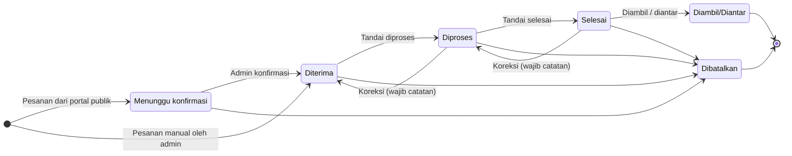
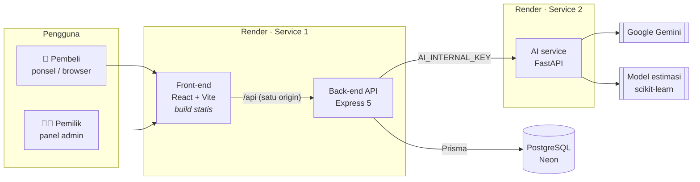

# LAVE STREAT
<div align="center">

Aplikasi web **prototype** untuk UMKM jasa cuci sepatu (tim capstone A26-CS119, Asah 2026). Semua data adalah **data dummy**; hasilnya bukan klaim dampak bisnis nyata.


Dokumen: `docs/` (mulai dari `AGENTS.md`, lalu `docs/PRD.md`).
<h1>LAVE STREAT</h1>

## Prasyarat
<p>
  <strong>Aplikasi web prototype untuk UMKM jasa cuci sepatu di Sidoarjo &amp; Surabaya.</strong><br />
  Pembeli memesan dan melacak dari ponsel. Pemilik usaha mengelola antrean, foto, nota, dan dasbor bisnis dari satu panel.
</p>

- Node.js 24 (lihat `.nvmrc`, minimum 22.22)
- Python 3.13 (lihat `ai-service/.python-version`)
<p>
  <a href="https://github.com/kurukururing/lavestreat/actions/workflows/ci.yml"></a>
  
  
  
  
</p>

<p>
  
  
  
  
  
  
  
  
</p>

<p>
  <a href="#-demo"><strong>Demo</strong></a> ·
  <a href="#-tampilan"><strong>Tampilan</strong></a> ·
  <a href="#-fitur-utama"><strong>Fitur</strong></a> ·
  <a href="#-memulai"><strong>Memulai</strong></a> ·
  <a href="#-tim"><strong>Tim</strong></a>
</p>

</div>

> [!IMPORTANT]
> Proyek ini adalah **prototype capstone** tim **A26-CS119 (Asah 2026)**. Semua data di dalamnya adalah **data dummy**, dan hasilnya **bukan klaim dampak bisnis nyata**.

---

## 📑 Daftar isi

- [Tentang proyek](#-tentang-proyek)
- [Demo](#-demo)
- [Tampilan](#-tampilan)
- [Fitur utama](#-fitur-utama)
- [Alur status pesanan](#-alur-status-pesanan)
- [Arsitektur](#-arsitektur)
- [Tech stack](#-tech-stack)
- [Struktur folder](#-struktur-folder)
- [Memulai](#-memulai)
- [Variabel lingkungan](#-variabel-lingkungan)
- [Perintah yang tersedia](#-perintah-yang-tersedia)
- [Pengujian & kualitas kode](#-pengujian--kualitas-kode)
- [Deployment (Render)](#-deployment-render)
- [Status pengembangan](#-status-pengembangan)
- [Tim](#-tim)
- [Lisensi](#-lisensi)

---

## 💡 Tentang proyek

**LAVE STREAT** adalah UMKM jasa cuci sepatu yang melayani Sidoarjo dan Surabaya. Pesanannya selama ini dicatat manual lewat chat WhatsApp. Prototype ini menguji bagaimana sebuah aplikasi web sederhana bisa membantu dua pihak:

| Untuk siapa | Masalah | Solusi di aplikasi |
| --- | --- | --- |
| 👟 **Pembeli** | Tidak tahu harga pasti, sepatunya sedang diapakan, dan kapan selesai. | Katalog tarif yang jelas, form pesan 4 langkah, dan halaman **lacak pesanan** dengan status, estimasi selesai, foto, serta nota. |
| 🧑‍💼 **Pemilik usaha** | Pesanan tercecer di chat, estimasi waktu hanya dikira-kira, dan tidak ada gambaran bisnis. | **Panel admin** berisi antrean dan status, pengisian form otomatis dari teks chat (AI), **estimasi durasi pengerjaan (AI)**, foto sebelum/sesudah, nota, dan **dasbor bisnis**. |

---

## 🚀 Demo

| | Tautan |
| --- | --- |
| 🌐 Aplikasi (produksi) | _`https://<isi-url-render-anda>.onrender.com`_ |
| 🔐 Panel admin | _`https://<isi-url-render-anda>.onrender.com/admin`_ |
| 🎥 Video demo (opsional) | _`<isi-tautan-video>`_ |

Untuk mencoba **tanpa back-end dan database**, jalankan front-end dalam [mode mock](#mode-mock-front-end-tanpa-back-end):

| Akun admin mock | ID pesanan contoh untuk halaman **Lacak** |
| --- | --- |
| `owner` / `dummy-owner` | `LS-7K3M9QW2` (menunggu konfirmasi) · `LS-H4TR8WN5` (diterima) · `LS-P2XN5DK7` (diproses) · `LS-B9CF3KA4` (selesai) · `LS-M6VJ2ET8` (diambil/diantar) · `LS-R8YT4AZ3` (dibatalkan) |

---

## 📸 Tampilan

> Semua screenshot diambil dari **mode mock** dengan data dummy.

### Portal pembeli (responsif, dirancang untuk ponsel)

<p align="center">
  
</p>

<table>
  <tr>
    <td width="50%"><p align="center"><b>Beranda</b>: hero, tarif mulai, dan pencarian ID pesanan</p></td>
    <td width="50%"><p align="center"><b>Pesan</b>: 4 langkah (layanan → metode → data → ringkasan)</p></td>
  </tr>
  <tr>
    <td colspan="2"><p align="center"><b>Lacak pesanan</b>: status, estimasi selesai, dan ringkasan biaya</p></td>
  </tr>
</table>

### Panel admin (pemilik usaha)

<table>
  <tr>
    <td colspan="2"><p align="center"><b>Dasbor</b>: total pesanan, pendapatan, status, periode tersibuk, layanan terlaris, dan akurasi estimasi</p></td>
  </tr>
  <tr>
    <td width="50%"><p align="center"><b>Antrean pesanan</b> dengan filter status</p></td>
    <td width="50%"><p align="center"><b>Detail pesanan</b>: estimasi AI, nota, dan riwayat status</p></td>
  </tr>
  <tr>
    <td colspan="2"><p align="center"><b>Pesanan baru</b>: tempel chat WhatsApp, lalu AI mengisi form untuk diperiksa admin</p></td>
  </tr>
</table>

---

## ✨ Fitur utama

### 👟 Portal pembeli

- **Katalog layanan & tarif**: 9 layanan (Easy, Medium, Deep, White, Leather, Suede, Boots, Kids, Express), 2 add-on (Unyellowing, Fast Track), dan 2 produk perawatan.
- **Pesan online dalam 4 langkah**: pilih layanan → metode (**dijemput kurir** atau **antar sendiri**) → data diri → ringkasan, termasuk unggah foto kondisi sepatu.
- **Ongkir flat per area**: Sidoarjo Rp5.000, Surabaya Rp10.000, antar sendiri gratis. Total final tetap dihitung ulang oleh server.
- **Lacak pesanan dengan ID** (`LS-XXXXXXXX`): linimasa status, estimasi selesai, ringkasan biaya, foto sebelum/sesudah, dan nota.
- **Galeri sebelum–sesudah** dengan slider perbandingan.
- Halaman **Cara kerja**, **Kontak**, dan **Privasi**.

### 🧑‍💼 Panel admin

- **Login pemilik** berbasis sesi.
- **Antrean pesanan** dengan filter status, pencarian ID/nama/nomor, dan paginasi.
- **Konfirmasi & ubah status** maju atau mundur satu langkah (mundur wajib disertai catatan), serta pembatalan.
- **Pesanan baru manual** dan **isi otomatis dari teks chat WhatsApp** menggunakan AI (Gemini); hasilnya tetap diperiksa admin sebelum disimpan.
- **Estimasi durasi pengerjaan (AI)** yang bisa dikoreksi manual (1–14 hari).
- **Foto sebelum & sesudah** per pesanan, serta **nota** yang bisa dipratinjau dan diunduh.
- **Draf pesan aftercare** (tips perawatan setelah selesai) untuk disalin ke WhatsApp.
- **Data pelanggan** beserta riwayat pesanannya.
- **Dasbor bisnis**: total pesanan, pendapatan, sebaran status, periode tersibuk per hari dan per jam, rasio jemput vs antar, layanan terlaris, dan akurasi estimasi.

### ⚡ Kualitas

- **Mobile-first** dan responsif, dengan bilah aksi lengket di ponsel.
- **Performa**: halaman dimuat secara _lazy_, gambar WebP dimuat saat terlihat, _prefetch_ saat kursor mengarah ke tautan, kompresi gzip, dan cache aset jangka panjang.
- **Keamanan**: `helmet` (CSP), IP disimpan dalam bentuk hash, rate limit, kunci internal antar-layanan, dan pemindaian rahasia `gitleaks` di CI.
- **Aksesibilitas**: kontras warna diperiksa (≥ 4,5 : 1) dan navigasi papan ketik.

---

## 🔄 Alur status pesanan



Item, jadwal, dan alamat hanya bisa diubah sebelum status **Diproses**. Status **Diambil/Diantar** dan **Dibatalkan** bersifat final.

---

## 🏗️ Arsitektur



- **Satu origin**: Express menyajikan hasil build Vite sekaligus API `/api/*`, jadi tidak perlu CORS. Saat development, Vite meneruskan `/api` ke Express.
- **AI service terpisah**: back-end memanggil FastAPI dengan kunci internal dan batas waktu. Jika AI gagal, admin tetap bisa mengisi manual (estimasi _baseline_).
- **`shared/`**: konstanta bersama (katalog, ongkir, label status) dipakai oleh front-end, back-end, dan mock.
- **`data-science/`**: data dummy, notebook, dan skrip latih/validasi model estimasi durasi.

---

## 🧰 Tech stack

| Lapisan | Teknologi |
| --- | --- |
| **Front-end** | React 19, React Router 8, Vite 8, Tailwind CSS 4, Radix UI (pola shadcn/ui), Lucide Icons, Recharts, Sonner, Axios |
| **Back-end** | Node.js 24, Express 5, Prisma 7 (`@prisma/adapter-pg`), Zod, Helmet, compression |
| **Database** | PostgreSQL (Neon) |
| **AI service** | Python 3.13, FastAPI, Pydantic, Uvicorn, Google Gemini (`google-genai`), scikit-learn |
| **Data science** | pandas, scikit-learn, joblib, Jupyter Notebook |
| **Pengujian** | Vitest, Testing Library, MSW (mock API), Supertest, Playwright (E2E), pytest |
| **Kualitas kode** | ESLint, Prettier, Ruff, gitleaks |
| **CI/CD & hosting** | GitHub Actions, Render |
| **Desain** | Figma (hi-fi), font Poppins & Inter |

---

## 📁 Struktur folder

```text
lavestreat/
├── frontend/              # React + Vite (portal pembeli & panel admin)
│   ├── public/            #   service worker MSW
│   ├── src/
│   │   ├── api/           #   klien HTTP (publik & admin)
│   │   ├── app/           #   router, kerangka admin, loader
│   │   ├── assets/        #   logo, foto beranda, galeri sebelum/sesudah
│   │   ├── components/    #   layout & komponen UI (pola shadcn/ui)
│   │   ├── features/      #   modul per fitur (dasbor, form pesanan, detail, dll.)
│   │   ├── hooks/         #   custom hooks
│   │   ├── lib/           #   util format, status, bisnis
│   │   ├── mocks/         #   handler MSW + data dummy
│   │   └── pages/         #   halaman publik & admin
│   └── tests/             #   Vitest + Testing Library
├── backend/               # Express 5 + Prisma
│   ├── prisma/            #   schema, migrasi, seed katalog
│   ├── scripts/           #   buat/reset admin, hapus data dummy
│   ├── src/
│   │   ├── config/        #   validasi env
│   │   ├── middleware/    #   error handler, fallback SPA
│   │   └── modules/       #   auth, orders, photos, invoice, estimate, chat, dashboard, ...
│   └── tests/
├── ai-service/            # FastAPI (estimasi durasi, ekstraksi chat, aftercare)
│   ├── app/               #   routers, schemas, services, prompts
│   ├── models/            #   artefak model terlatih
│   └── tests/             #   pytest
├── data-science/          # data dummy, notebook, skrip latih & evaluasi
├── shared/                # konstanta bersama (@lavestreat/shared)
├── .github/
│   ├── workflows/ci.yml   #   lint, tes, build, pemindaian rahasia
│   └── readme/            #   gambar untuk README ini
├── .env.example
└── playwright.config.js
```

---

## Mulai
## 🏁 Memulai

### Prasyarat

| Alat | Versi |
| --- | --- |
| Node.js | **24** (lihat `.nvmrc`, minimum 22.22) |
| npm | bawaan Node.js |
| Python | **3.13** (lihat `ai-service/.python-version`) |
| PostgreSQL | Neon (atau PostgreSQL lokal) |

### Mode mock (front-end tanpa back-end)

Cara tercepat untuk melihat aplikasi, tanpa database dan tanpa API key:

```bash
npm install
cp .env.example backend/.env          # isi nilainya
npm run dev -w backend                # Express, port 3000
npm run dev -w frontend               # Vite, proxy /api ke Express
npm run dev -w frontend -- --mode mock
```

Buka `http://localhost:5173`. Semua panggilan `/api` dijawab oleh **MSW** dari `frontend/src/mocks/` (data dummy, hilang saat halaman dimuat ulang). Login admin mock: **`owner` / `dummy-owner`**.

> [!NOTE]
> Belum dimock: unduh foto dan nota (PUB-04, PUB-05, ADM-14, ADM-15) serta fitur P1 (ADM-16 s.d. ADM-18). Tes front-end memakai handler mock yang sama.

### Mode penuh

**1. Instal dependensi & siapkan env**

```bash
npm install
cp .env.example backend/.env       # isi nilainya, lihat tabel di bawah
cp .env.example ai-service/.env    # cukup bagian ai-service
```

**2. Siapkan database**

```bash
npm run db:generate -w backend     # generate Prisma Client
npm run db:migrate -w backend      # jalankan migrasi
npm run db:seed -w backend         # isi katalog layanan
npm run admin:create -w backend    # buat akun admin dari ADMIN_USERNAME/ADMIN_PASSWORD
```

**3. Jalankan back-end & front-end** (dua terminal)

```bash
npm run dev -w backend             # Express, http://localhost:3000
npm run dev -w frontend            # Vite, http://localhost:5173 (proxy /api ke Express)
```

**4. Jalankan AI service** (terminal ketiga)

```bash
cd ai-service
python -m venv .venv
.venv/Scripts/pip install -r requirements-dev.txt   # Linux/macOS: .venv/bin/pip
uvicorn app.main:app --reload
uvicorn app.main:app --reload                       # http://localhost:8000
```

Perintah lain (lint, tes, migrasi, seed, skrip admin) ada di `AGENTS.md` Bagian 8.
Gunakan `.venv/Scripts/activate` (Windows) atau `source .venv/bin/activate` (Linux/macOS) bila `uvicorn` tidak ditemukan.

### Front-end tanpa back-end (mock API)
---

```bash
npm run dev -w frontend -- --mode mock
```
## 🔑 Variabel lingkungan

Salin `.env.example` ke `backend/.env` (back-end + skrip) dan ke `ai-service/.env` (layanan AI). **Jangan pernah commit nilai asli.**

<details>
<summary><b>Back-end</b> (<code>backend/.env</code>)</summary>

| Variabel | Contoh | Keterangan |
| --- | --- | --- |
| `NODE_ENV` | `development` | `development` / `production` |
| `PORT` | `3000` | Port Express |
| `DATABASE_URL` | `postgresql://...` | Koneksi **pooled** Neon, dipakai aplikasi |
| `DIRECT_URL` | `postgresql://...` | Koneksi **direct** Neon, dipakai CLI Prisma untuk migrasi |
| `SESSION_SECRET` | _string acak panjang_ | Rahasia penandatangan sesi admin |
| `IP_HASH_SALT` | _string acak_ | Salt untuk hash IP (rate limit tanpa menyimpan IP asli) |
| `APP_ORIGIN` | `http://localhost:5173` | Origin aplikasi |
| `FRONTEND_DIST_DIR` | `../frontend/dist` | Lokasi hasil build front-end yang disajikan Express |
| `TRUST_PROXY_HOPS` | `0` (lokal) / `1` (Render) | Jumlah proxy tepercaya, agar `req.ip` benar |
| `AI_SERVICE_URL` | `http://localhost:8000` | URL AI service |
| `AI_INTERNAL_KEY` | _string acak_ | Kunci internal back-end ↔ AI service (harus sama di keduanya) |
| `AI_TIMEOUT_MS` | `10000` | Batas waktu panggilan ke AI service |
| `SERVICE_AREA_BBOX` | _koordinat_ | Batas wilayah layanan (opsional) |
| `ADMIN_USERNAME` | `owner` | Hanya untuk skrip `admin:create` / `admin:reset` |
| `ADMIN_PASSWORD` | _kata sandi kuat_ | Hanya untuk skrip `admin:create` / `admin:reset` |

</details>

<details>
<summary><b>AI service</b> (<code>ai-service/.env</code>)</summary>

| Variabel | Contoh | Keterangan |
| --- | --- | --- |
| `PORT` | `8000` | Port FastAPI |
| `AI_INTERNAL_KEY` | _sama dengan back-end_ | Memverifikasi panggilan dari back-end |
| `GEMINI_API_KEY` | _API key_ | Kunci Google Gemini |
| `GEMINI_MODEL` | _nama model_ | Model Gemini yang dipakai |
| `DOCS_ENABLED` | `false` | `true` untuk mengaktifkan `/docs` (Swagger) |

</details>

<details>
<summary><b>Front-end</b> (opsional, hanya dev)</summary>

| Variabel | Contoh | Keterangan |
| --- | --- | --- |
| `VITE_DEV_API_TARGET` | `http://localhost:3000` | Target proxy `/api` saat `npm run dev`. **Tidak boleh berisi rahasia.** |

</details>

---

## 🛠️ Perintah yang tersedia

| Perintah | Fungsi |
| --- | --- |
| `npm run lint` | ESLint + cek format Prettier (seluruh repo) |
| `npm run format` | Rapikan format dengan Prettier |
| `npm run test:e2e` | Tes end-to-end Playwright |
| `npm run dev -w frontend` | Server dev Vite |
| `npm run dev -w frontend -- --mode mock` | Server dev Vite dengan mock API (MSW) |
| `npm run build -w frontend` | Build produksi front-end |
| `npm run test -w frontend` | Tes unit/komponen front-end (Vitest) |
| `npm run dev -w backend` | Express dengan auto-reload |
| `npm run test -w backend` | Tes back-end (Vitest + Supertest) |
| `npm run db:generate -w backend` | Generate Prisma Client |
| `npm run db:migrate -w backend` | Buat & jalankan migrasi (dev) |
| `npm run db:deploy -w backend` | Jalankan migrasi (produksi) |
| `npm run db:seed -w backend` | Isi katalog layanan |
| `npm run admin:create -w backend` | Buat akun admin |
| `npm run admin:reset -w backend` | Reset kata sandi admin |
| `npm run data:purge -w backend` | Hapus data dummy |

AI service (dari folder `ai-service/`): `ruff check .`, `ruff format .`, `pytest`.

---

## 🧪 Pengujian & kualitas kode

Setiap _pull request_ dan _push_ ke `main` menjalankan [GitHub Actions](.github/workflows/ci.yml) dengan tiga job:

| Job | Langkah |
| --- | --- |
| **js** | `npm ci` → generate Prisma → lint → tes front-end → tes back-end → build front-end |
| **ai-service** | `pip install` → `ruff check` → `ruff format --check` → `pytest` |
| **secrets** | Pemindaian seluruh riwayat git dengan **gitleaks** |

---

## ☁️ Deployment (Render)

| Service | Root | Build command | Start command |
| --- | --- | --- | --- |
| **1. Web + API** (Express menyajikan front-end) | `/` | `npm ci --include=dev && npm run build -w frontend && npm run db:generate -w backend` | `npm run db:deploy -w backend && node backend/src/server.js` |
| **2. AI service** (FastAPI) | `ai-service` | `pip install -r requirements.txt` | `uvicorn app.main:app --host 0.0.0.0 --port $PORT` |

Jangan lupa mengisi variabel lingkungan di dashboard Render, termasuk `TRUST_PROXY_HOPS=1` dan `NODE_ENV=production`.

---

## 🗺️ Status pengembangan

| Bagian | Status |
| --- | --- |
| Desain hi-fi (Figma) & design token | ✅ Selesai |
| Front-end portal pembeli | ✅ Selesai (berjalan dengan mock API) |
| Front-end panel admin | ✅ Selesai (berjalan dengan mock API) |
| Optimasi performa (lazy loading, Lighthouse) | ✅ Selesai |
| Skema database, migrasi awal, seed katalog | ✅ Selesai |
| Endpoint API back-end (`/api/public/*`, `/api/admin/*`) | 🚧 Dalam pengerjaan |
| AI service: estimasi durasi, ekstraksi chat, aftercare | 🚧 Dalam pengerjaan |
| Data dummy & pelatihan model estimasi | 🚧 Dalam pengerjaan |
| Tes end-to-end Playwright | ⏳ Direncanakan |

---

## 👥 Tim

Tim capstone **A26-CS119** · **Asah 2026**

| Foto | Nama | Peran | GitHub |
| :---: | --- | --- | --- |
|  | _Nama anggota_ | _Project lead / Full-stack_ | [@kurukururing](https://github.com/kurukururing) |
|  | _Nama anggota_ | _Front-end_ | _@username_ |
|  | _Nama anggota_ | _Back-end_ | _@username_ |
|  | _Nama anggota_ | _AI / Machine Learning_ | _@username_ |
|  | _Nama anggota_ | _Data Science_ | _@username_ |

**Mitra UMKM:** LAVE STREAT, jasa cuci sepatu di Sidoarjo & Surabaya.

---

## 📄 Lisensi

Semua panggilan `/api` dijawab MSW dari `frontend/src/mocks/` (data dummy, hilang saat halaman dimuat ulang). Login admin mock: `owner` / `dummy-owner`. Belum dimock: unduh foto dan nota (PUB-04, PUB-05, ADM-14, ADM-15) serta fitur P1 (ADM-16 s.d. ADM-18). Tes front-end memakai handler yang sama.
_Tentukan lisensi proyek ini, misalnya MIT, atau tulis "Hak cipta © 2026 Tim A26-CS119. Seluruh hak dilindungi." bila tidak open source._

## Produksi (Render)
Foto produk dan logo LAVE STREAT adalah milik UMKM LAVE STREAT dan hanya digunakan untuk keperluan prototype ini.

- Service 1 (Express + front-end). Build: `npm ci --include=dev && npm run build -w frontend && npm run db:generate -w backend`. Start: `npm run db:deploy -w backend && node backend/src/server.js`.
- Service 2 (FastAPI, root `ai-service`). Build: `pip install -r requirements.txt`. Start: `uvicorn app.main:app --host 0.0.0.0 --port $PORT`.
<div align="center">
  <br />
  <sub>Dibuat dengan 💙 oleh tim A26-CS119 untuk capstone Asah 2026.</sub>
</div>
